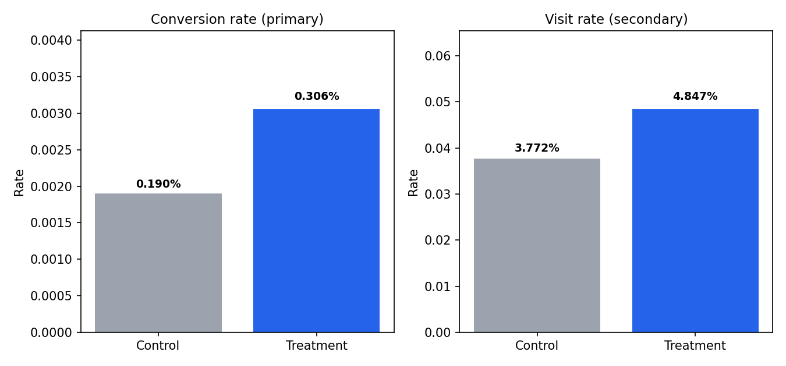
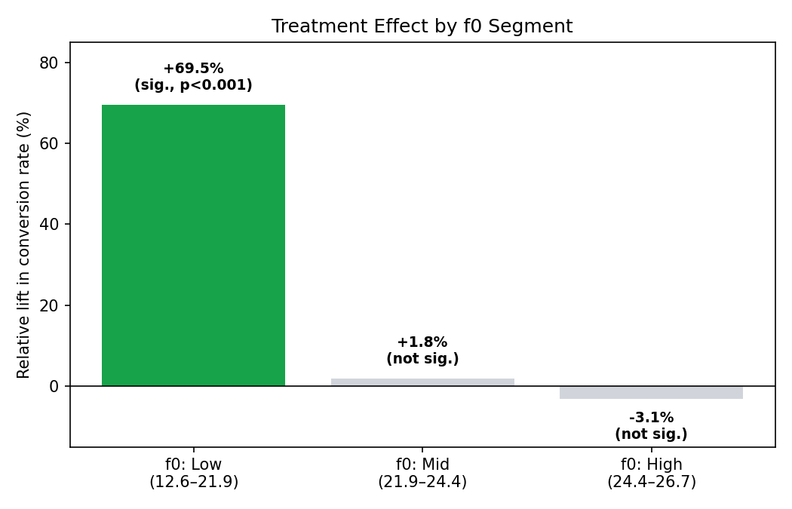
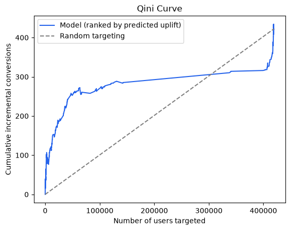

<!--
name: readme
description: A/B test analysis walkthrough — Criteo Uplift dataset, ad-exposure incrementality test
-->

# A/B Test Analysis: Ad Exposure Incrementality Test (Criteo Uplift Dataset)

**Problem statement:** Does ad exposure increase user conversion compared to a
holdout group? This project runs a full A/B-testing and causal-inference
pipeline on the Criteo Uplift dataset — hypothesis framing, power analysis,
randomization validation, significance testing, variance reduction,
multiple-testing correction, segment analysis, and uplift modeling — to reach
a data-backed ship/no-ship recommendation.

---

## Table of Contents

1. [Business Context & Hypothesis](#1-business-context--hypothesis)
2. [Dataset](#2-dataset)
3. [Metrics](#3-metrics)
4. [Methodology & Results](#4-methodology--results)
   - [4.1 Power Analysis](#41-power-analysis)
   - [4.2 Sample Ratio Mismatch (SRM) Check](#42-sample-ratio-mismatch-srm-check)
   - [4.3 Significance Testing](#43-significance-testing)
   - [4.4 CUPED Variance Reduction](#44-cuped-variance-reduction)
   - [4.5 Multiple Testing Correction](#45-multiple-testing-correction)
   - [4.6 Segment Analysis](#46-segment-analysis)
   - [4.7 Uplift Modeling](#47-uplift-modeling)
5. [Limitations](#5-limitations)
6. [Recommendation](#6-recommendation)

---

## 1. Business Context & Hypothesis

This dataset represents an ad-incrementality test: `treatment = 1` means a
user was eligible to be shown ads; `treatment = 0` means they were
deliberately withheld as a holdout, regardless of what ads would otherwise
have targeted them.

**Hypothesis:** Ad exposure increases the probability that a user visits the
advertiser's site and converts, relative to the holdout group.

## 2. Dataset

- **Source:** [Criteo Uplift Prediction dataset](https://huggingface.co/datasets/criteo/criteo-uplift) (Diemert et al., 2018), accessed via its Hugging Face mirror after the `scikit-uplift` library's default S3 host returned a 403 error.
- **Full size:** 13,979,592 rows (the "v2.1" release), ~311MB compressed.
- **Sampling:** The full compressed file was streamed and parsed in 500,000-row chunks; each row was kept independently with 10% probability (Bernoulli sampling) across the **entire** file, not just a prefix of it. This matters — an earlier attempt that simply took the first 1.3M rows of a streaming read landed entirely inside one sub-experiment and returned 100% `treatment=1`, with zero control rows. The dataset is assembled from several underlying incrementality tests concatenated together, so a contiguous slice is not a representative sample; sampling independently across every chunk is.
- **Final sample used in this analysis:** 1,397,106 rows.
- **Columns:** `f0`–`f11` (12 anonymized, pre-treatment user features), `treatment`, `exposure`, `visit`, `conversion`.

**Sanity check applied after loading (and after every re-load):**
```python
treat_share = df["treatment"].mean()
assert 0.05 < treat_share < 0.95, f"Suspicious treatment share: {treat_share:.2%}"
```
This exists specifically because of the sampling failure above — it catches a
degenerate sample immediately rather than letting a bad load silently corrupt
every downstream step.

## 3. Metrics

| Role | Metric | Type | Notes |
|---|---|---|---|
| **Primary** | `conversion` | Binary | The business-critical outcome; drives the ship/no-ship call. |
| **Secondary** | `visit` | Binary | Upstream of conversion in the funnel; used as a consistency check — a real effect should move both metrics in the same direction. |
| **Guardrail** | — | — | **None available.** This anonymized ads dataset has no cost, revenue, or complaint column, so there is no true "don't make this worse" metric to test. This is stated explicitly as a limitation rather than a step that was skipped. |

## 4. Methodology & Results

### 4.1 Power Analysis

Before trusting any result, we checked whether the available sample could
realistically detect the effect size of interest.

| Input | Value |
|---|---|
| Baseline conversion rate (control) | 0.1905% |
| Target MDE | 10% relative lift |
| Alpha (two-sided) | 0.05 |
| Power | 0.80 |
| **Required N per arm** | **863,055** |
| **Actual control-arm size** | **208,935** |
| Verdict | **Underpowered** for a 10% relative lift |

Because the result was underpowered for the original target, we also solved
the calculation in reverse — given the *actual* sample size, what is the
smallest lift this test can reliably detect?

| Achievable MDE at actual sample size | Value |
|---|---|
| Relative | **20.8%** |
| Absolute | **0.0397%** |

This is the honest bar the significance test results (Section 4.3) should be
read against, not the original 10% target — "not significant" at this sample
size would not mean "no effect," only "no effect of at least ~20.8%."

### 4.2 Sample Ratio Mismatch (SRM) Check

SRM checks whether the treatment/control split matches what it should be. A
mismatch suggests a randomization, logging, or filtering bug — and would
invalidate every comparison that follows.

**First attempt — a false alarm, worth documenting:**

| | Value |
|---|---|
| Observed treatment share | 85.0452% |
| Expected (from the original 2018 Criteo paper) | 84.6% |
| Chi-square | 212.503 |
| p-value | 0.0000 |
| Verdict | SRM "detected" |

At n≈1.4M, a chi-square test is sensitive enough to flag even a ~0.45
percentage-point gap as highly significant. Investigating further: the 84.6%
figure comes from the original 25.3-million-row 2018 release, while this
project uses a different, later release (`v2.1`, 13.98M rows) — and other
work analyzing that specific release reports its ratio as closer to 85%. The
correct benchmark is the ratio of the actual file sampled from, not a
headline figure from a paper describing a different version of the dataset.

**Corrected check — against the true ratio of the actual source file:**

| | Value |
|---|---|
| Observed treatment share | 85.0452% |
| True ratio in the downloaded source file | 85.0000% |
| Chi-square | 2.233 |
| p-value | 0.1351 |
| Verdict | **No SRM — sampling is healthy** |

### 4.3 Significance Testing

Two-proportion z-tests comparing treatment vs. control.

| Metric | Control rate | Treatment rate | Absolute lift | Relative lift | z | p-value |
|---|---|---|---|---|---|---|
| **Conversion (primary)** | 0.190% | 0.306% | +0.115pp | **+60.6%** | 9.06 | 1.25 × 10⁻¹⁹ |
| **Visit (secondary)** | 3.772% | 4.847% | +1.075pp | **+28.5%** | 21.43 | 6.60 × 10⁻¹⁰² |



Both metrics moved in the same direction, both are significant by many
orders of magnitude, and both comfortably clear the ~20.8%-relative
detectable-effect bar established in Section 4.1 — this is a large,
internally consistent effect, not a borderline or noise-driven result.

### 4.4 CUPED Variance Reduction

CUPED uses a pre-treatment covariate (unaffected by treatment, since it's
measured before assignment) to remove some of the outcome's variance that
has nothing to do with treatment — tightening the estimate without
collecting more data.

The two features most correlated with `conversion` were used as independent
checks on each other:

| Covariate | Correlation with conversion | theta | Variance reduction | CUPED-adjusted lift |
|---|---|---|---|---|
| `f11` | −0.315 | −0.732 | 9.92% | 0.000987 |
| `f4` (robustness check) | +0.302 | +0.047 | 9.14% | 0.000966 |

Both covariates converge on a similar adjusted lift (~0.00097), noticeably
below the raw estimate (0.00115). A balance check on `f11` across arms
(mean −0.17102 treatment vs. −0.17079 control) found a statistically
significant but numerically tiny gap; the shift in the CUPED estimate is
fully explained by `theta × (mean gap)`, and the agreement between two
independent covariates supports treating ~0.00097 as the more reliable
estimate rather than an artifact of either feature individually.

### 4.5 Multiple Testing Correction

Benjamini-Hochberg correction applied across the conversion and visit tests,
since both were tested against the same underlying hypothesis.

| Metric | p (raw) | p (BH-adjusted) | Significant |
|---|---|---|---|
| Conversion | 1.25 × 10⁻¹⁹ | 1.25 × 10⁻¹⁹ | True |
| Visit | 6.60 × 10⁻¹⁰² | 1.32 × 10⁻¹⁰¹ | True |

The correction does not change either conclusion — both raw p-values were
already far beyond the threshold where a multiple-comparisons adjustment
could matter. Applied as standard practice, not because either result was
borderline.

### 4.6 Segment Analysis

**A methodological pitfall worth documenting:** an initial attempt segmented
users by quartiles of `f11` (the strongest CUPED covariate). This produced
nonsensical results — one quartile showing a −90.8% "lift" — because `f11`
is dominated by a single repeated value in 98.6% of rows, so `qcut` quartiles
on it reflected row order in the file, not real differences between users.

**Fix:** every feature (`f0`–`f11`) was screened for how concentrated its
values were before being used to segment:

| Feature | Most common value's share of rows | Usable for segmentation? |
|---|---|---|
| f0 | 26.5% | ✅ Yes |
| f6 | 26.5% | ✅ Yes |
| f1, f3, f4, f5, f9 | 80–99% | ❌ No — one value dominates |
| f2, f7, f8, f10 | 52–95%, but with many unique values too | ⚠️ Set aside — likely default/missing-value patterns |
| f11 | 98.6% | ❌ No — caused the initial pitfall above |

`f0` was used to split users into value-based groups (via `pd.qcut(...,
duplicates="drop")`, which merged one pair of colliding bin edges and
produced 3 groups instead of 4). Before trusting the split, treatment share
was checked across groups to rule out confounding:

| Segment (f0 range) | N | Treatment share |
|---|---|---|
| (12.615, 21.926] | 698,554 | 85.19% |
| (21.926, 24.444] | 349,275 | 84.94% |
| (24.444, 26.745] | 349,277 | 84.85% |

All three sit close to the overall ~85% split — these groups are comparable,
and any conversion-rate difference between them reflects a real effect, not
a sampling artifact.

**Treatment effect by segment:**

| Segment (f0 range) | Control rate | Treatment rate | Relative lift | p (BH-adjusted) | Significant |
|---|---|---|---|---|---|
| **(12.615, 21.926]** | 0.327% | 0.554% | **+69.5%** | 2.15 × 10⁻²⁰ | **True** |
| (21.926, 24.444] | 0.074% | 0.076% | +1.8% | 0.917 | False |
| (24.444, 26.745] | 0.040% | 0.039% | −3.1% | 0.917 | False |



The overall +60.6% average lift (Section 4.3) is not a uniform effect across
all users — it is concentrated almost entirely in the lowest `f0` range,
which also has a notably higher baseline conversion rate than the other two
segments even before treatment. The other two segments show no detectable
effect, not merely a smaller one.

### 4.7 Uplift Modeling

A two-model (T-learner) approach was used to predict, per user, the expected
change in conversion probability from ad exposure — generalizing the
single-feature segment analysis above across all 12 features at once.

**Setup:** 70/30 train/test split, stratified by treatment. Two independent
`HistGradientBoostingClassifier` models (max depth 4) were trained — one on
control rows only, one on treatment rows only — and each test user's
predicted uplift is the difference between the two models' predictions for
that user.

| | Value |
|---|---|
| Control-model training rows | 146,254 |
| Treatment-model training rows | 831,720 |
| Test set size | 419,132 |
| **Qini AUC** | **0.0817** |
| Uplift captured in top 30% (by predicted uplift) | 0.0027 (vs. 0.00115 overall — >2x concentration) |



The model's ranking clearly outperforms random targeting (Qini AUC > 0, and
the Qini curve sits well above the random-targeting diagonal for most of its
range). The curve's flat-then-jump shape reflects a real, documented
property of the data rather than a bug: ~46% of test users share one of two
tied predicted-uplift values, a direct consequence of several near-constant
features (the same ones excluded from segmentation in Section 4.6) limiting
how finely the model can distinguish between users.

**Cross-validation against the manual segment finding:** the composition of
the model's top-30%-predicted-uplift group was checked against the `f0`
segments from Section 4.6:

| f0 segment | Share of top-30%-predicted-uplift group |
|---|---|
| (12.615, 21.938] — the responsive segment | **81.25%** |
| (21.938, 24.474] | 10.21% |
| (24.474, 26.745] | 8.54% |

Two independent methods — a manual, single-feature segment cut and a
12-feature predictive model — concentrate on the same group of users. This
agreement is strong evidence the effect is real and localized, not an
artifact of either method individually.

## 5. Limitations

- **No guardrail metric.** This anonymized dataset has no cost, revenue, or
  complaint signal, so there is no way to check whether ad exposure caused
  any negative side effect — only that it didn't reduce conversion or visits
  anywhere tested.
- **10% sample, not the full dataset.** Used for tractability on a local
  machine; sampling was validated to be unbiased (Section 2), but all
  figures are estimates from a sample, not the full 13.98M-row population.
- **Pooled sub-experiments.** The dataset is known to combine several
  distinct incrementality tests. This was directly responsible for the
  `f11` segmentation pitfall (Section 4.6) and is the most likely explanation
  for the near-constant features encountered throughout (Sections 4.6–4.7).
  Careful feature screening mitigated this, but it cannot be fully ruled out
  as a residual influence on the results.
- **Underpowered for small effects.** The primary test can reliably detect
  lifts of ~20.8% relative or larger (Section 4.1); a smaller true effect
  could exist in the "not significant" segments (Section 4.6) without this
  analysis being able to detect it.
- **A few extreme predicted-uplift values** (min −1.0, max 1.0) in the
  uplift model likely reflect low-confidence predictions in sparsely-observed
  feature regions rather than genuine effects.

## 6. Recommendation

**Ship, but targeted rather than blanket.**

The overall effect is large, statistically overwhelming, and confirmed by
CUPED, multiple-testing correction, and consistency between the primary and
secondary metric. However, segment analysis and the uplift model — two
independent methods — agree that this effect is concentrated in roughly half
of users (the lower `f0` range), while the remaining users show no
detectable benefit.

- **Primary recommendation:** prioritize ad spend on the responsive segment
  identified in Section 4.6/4.7, rather than rolling out uniformly — this
  captures the large majority of the incremental value more efficiently.
- **No evidence of harm:** the non-responsive segments show no significant
  negative effect either, so a broader rollout is inefficient, not risky.
- **Caveat to carry forward:** without a guardrail metric, this
  recommendation addresses conversion lift only — a production decision
  should also weigh media spend against the incremental conversions gained,
  which this analysis does not have the data to quantify.
